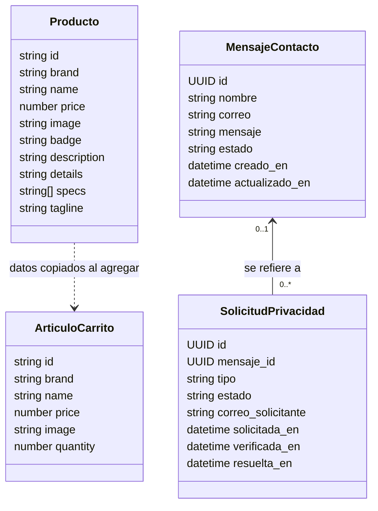
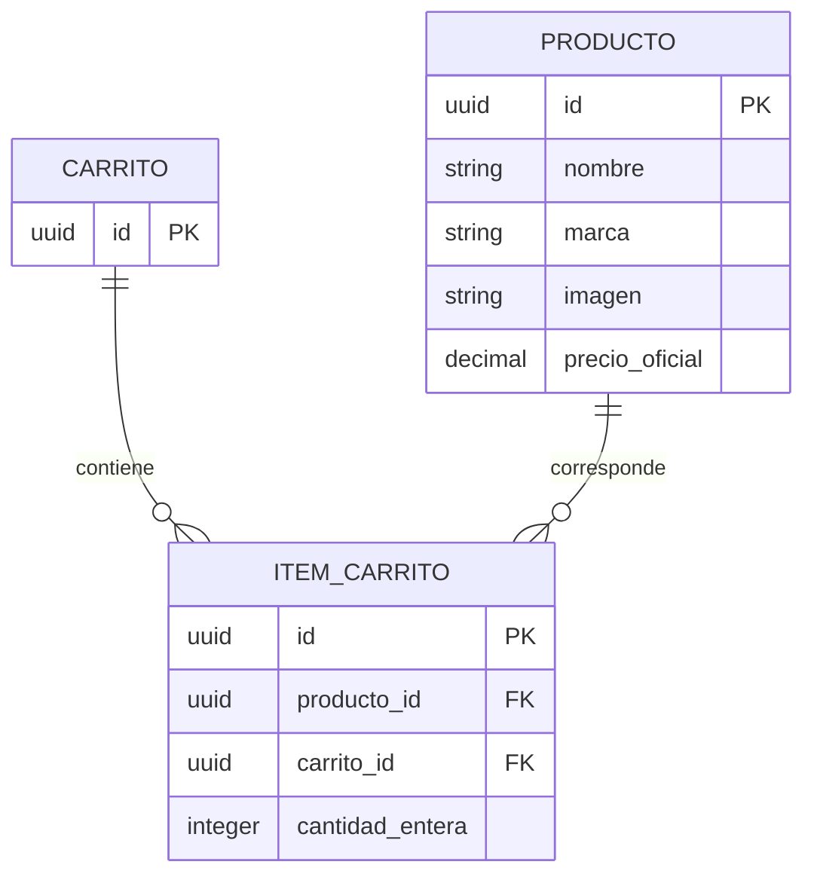

# Análisis de entidad, operaciones CRUD y seguridad de MobileZone

**Fecha:** 28 de octubre de 2026.
**Método:** inspección del proyecto React y pruebas de la restauración del carrito. La aplicación no tiene backend ni base de datos.

## 1. Descripción breve del sistema

MobileZone es una aplicación de presentación y selección de smartphones y accesorios, desarrollada con React y Vite.
Permite consultar productos, buscar, filtrar, comparar modelos, marcar favoritos y gestionar un carrito local.
La coordinación de compra se deriva a WhatsApp mediante un enlace que prepara el detalle de la selección.
Los productos están definidos en archivos JavaScript; el contacto y la suscripción muestran confirmaciones simuladas.
No se identificaron backend, base de datos, autenticación ni roles de usuario implementados.

### Alcance y estructura examinada

| Área | Archivos y responsabilidad |
|---|---|
| Configuración | `react-app/package.json`, `vite.config.js`, `index.html` y `.github/workflows/pages.yml`: dependencias, entrada, compilación y publicación estática. |
| Composición y navegación | `src/main.jsx`, `src/App.jsx`, `src/routing.js`: montaje, estado del carrito y selección de páginas. |
| Páginas | `src/pages/StorePages.jsx`: inicio, catálogo, comparación, ofertas, contacto, carrito, landing y página no encontrada. |
| Componentes | `src/components/`: tarjetas, modal, estructura de navegación y notificaciones. |
| Datos | `src/data/catalog.js` y `src/data/prices.js`: productos, especificaciones comparativas y precios fijos. |
| Presentación y pruebas | `src/App.css`, `src/index.css`, recursos públicos y `src/routing.test.js`. |
| Antecedentes | `.docs/Legacy/` contiene HTML, JavaScript y documentos de diseño anteriores; no constituye el modelo de ejecución React. Su imagen de tienda sí se importa desde `catalog.js`, línea 1. |

Las rutas declaradas son `/inicio`, `/smartphones`, `/comparar`, `/ofertas`, `/contacto`, `/carrito` y `/landing`; no incorporan comprobaciones de identidad o permisos. La gestión de estado utiliza hooks; no se identificaron Context API, Redux, `sessionStorage` ni llamadas de datos mediante `fetch` o Axios en el código activo. Esto no implica ausencia de tráfico: se cargan imágenes y fuentes externas y existen enlaces a servicios de terceros. Véanse [rutas](../react-app/src/routing.js#L1), [selección de páginas](../react-app/src/App.jsx#L120), [dependencias](../react-app/package.json#L12) y [fuentes externas](../react-app/index.html#L9).

## 2. Entidad principal: Producto

**Justificación.** El producto articula el catálogo, las ofertas, la comparación, los detalles y la selección para compra. Se encuentra en `homeProducts`, `catalogProducts`, `offerProducts` y `comparisonProducts`; la landing deriva objetos de esas colecciones. El carrito conserva una representación reducida del producto y añade cantidad. Por ello, Producto representa mejor el núcleo del negocio que un supuesto pedido o usuario, para los cuales no existe modelo implementado.

**Naturaleza del modelo.** Son objetos JavaScript con datos de demostración, sin interfaz TypeScript, esquema de base de datos ni validador de entidad. Todos los tipos siguientes son **inferidos** de los literales y de su utilización. «Obligatorio» describe la presencia y dependencia funcional observada; no representa una restricción formal del sistema.

| Campo | Tipo de dato | Descripción | Obligatorio | Sensible |
|---|---|---|---|---|
| `id` | `string` (inferido) | Identificador usado como clave de renderizado y para agrupar artículos del carrito. Puede variar entre secciones para un mismo modelo; solo se restauran IDs presentes en el catálogo. | Sí, inferido por uso. | No; dato público. |
| `brand` | `string` (inferido) | Marca pública presentada y utilizada en filtros. | Presente en productos actuales; restricción no especificada. | No; dato público de catálogo. |
| `name` | `string` (inferido) | Nombre público visible del modelo; el carrito restaurado lo obtiene del producto encontrado por ID. | Sí, inferido por uso; no es fuente de autoridad del precio. | No; dato público de catálogo. |
| `price` | `number` (inferido) | Precio de catálogo expresado en USD. El carrito restaurado lo reconstruye desde el producto del catálogo asociado al ID; no se confía en el valor persistido por el navegador. | Sí para mostrar y calcular el resumen local; la integridad comercial solo se garantiza con validación del servidor. | No es confidencial; su integridad comercial es crítica. |
| `image` | `string` (inferido) | URL pública de imagen del producto. El carrito restaurado la toma del catálogo, no del valor persistido. | Presente en productos actuales; sin validación formal de URL. | No; dato público de catálogo. |
| `badge` | `string` (inferido) | Etiqueta comercial: novedad, disponibilidad o descuento. No constituye inventario verificable. | No; hay productos sin el campo. | No. |
| `description` | `string` (inferido) | Texto breve de la tarjeta o variante de presentación. | No; los objetos base de comparación no lo incluyen. | No. |
| `details` | `string` (inferido) | Texto ampliado del modal, con alternativa en `description`. | No; no está en todas las variantes. | No. |
| `specs` | `string[]` (inferido) | Lista de especificaciones mostradas en el modal. | No; el modal utiliza una lista vacía si falta. | No. |
| `tagline` | `string` (inferido) | Frase comercial de los productos de comparación, heredada en algunas variantes de landing. | No; depende de la colección. | No. |

**Referencias:** [productos de inicio y catálogo](../react-app/src/data/catalog.js#L8), [ofertas](../react-app/src/data/catalog.js#L78), [comparación](../react-app/src/data/catalog.js#L101), [landing](../react-app/src/pages/StorePages.jsx#L271), [modal](../react-app/src/components/ProductModal.jsx#L20) y [formato monetario](../react-app/src/components/ProductCard.jsx#L31).

`previousPrice` se consulta en una condición visual de `ProductCard.jsx`, línea 6, pero no aparece como atributo en los objetos de producto inspeccionados; no se incorpora como campo de datos implementado. Las especificaciones de comparación están en `comparisonSpecs`, con `label`, `icon` y `values`; se relacionan con los productos por posición de columna, no mediante una clave de relación ([catálogo, líneas 116–120](../react-app/src/data/catalog.js#L116)). No existen campos estructurados de stock, propietario o categoría: las ofertas clasifican accesorios mediante el contenido del identificador ([StorePages.jsx, línea 171](../react-app/src/pages/StorePages.jsx#L171)).

### Representación asociada: artículo del carrito

No es una tabla de base de datos. Es un objeto de `cartItems`, guardado bajo `mobilezone-cart-items` en `localStorage`. Al restaurarlo, el campo `id` se usa para buscar el producto del catálogo y los demás datos del producto se reconstruyen desde esa coincidencia; el único dato propio de la línea es la cantidad.

| Campo | Tipo de dato | Descripción | Obligatorio | Sensible |
|---|---|---|---|---|
| `id` | `string` (inferido) | Identificador usado en esta implementación como clave de línea y para buscar el producto en `cartProducts`. No hay un ID independiente para la línea. | Sí; al restaurar debe ser un ID de producto existente. | No; identificador de catálogo. |
| `brand` | `string` (inferido) | Copia para presentación; al restaurar se toma del catálogo. | No en la línea restaurada si el producto no la define. | No; dato público de catálogo. |
| `name` | `string` (inferido) | Copia para presentación; al restaurar se toma del catálogo y no se usa como autoridad para el precio. | Sí para el catálogo actual. | No; dato público de catálogo. |
| `price` | `number` (inferido) | Copia derivada del precio del producto; al restaurar se descarta el valor persistido y se usa el precio del catálogo. | Sí para los cálculos mostrados en el cliente. | No es confidencial; integridad comercial crítica. |
| `image` | `string` (inferido) | Copia para presentación; al restaurar se toma del catálogo. | No; se sustituye por cadena vacía si falta. | No; dato público de catálogo. |
| `quantity` | `number` (inferido) | Cantidad seleccionada para la línea. | Sí; ahora debe ser un entero positivo. | Preferencia de compra; validar también en el servidor. |

El contador, subtotal y total se calculan; no son campos persistidos del Producto. El carrito no tiene entidad ni identificador de usuario: pertenece al almacenamiento del origen en ese perfil del navegador, no a un propietario autenticado. Los IDs de catálogo tampoco están normalizados globalmente entre superficies: por ejemplo, ofertas pueden definir un ID distinto para el mismo modelo. Por eso, una base de datos futura debe asignar al Producto un ID canónico y estable, compartido por catálogo, ofertas, comparación y landing. Referencias: [restauración](../react-app/src/App.jsx#L14), [persistencia](../react-app/src/App.jsx#L43), [alta](../react-app/src/App.jsx#L83) y [cálculos](../react-app/src/pages/StorePages.jsx#L248).

## 3. Diagrama de la entidad

El diagrama representa estructuras inferidas del frontend; no declara clases implementadas ni relaciones de base de datos. Los campos opcionales son los indicados en las tablas anteriores.



### Propuesta relacional para carrito, líneas y productos

El diagrama recibido representa una **propuesta para una futura base de datos**, no la estructura que existe hoy en `localStorage`. En ese modelo, cada línea tiene su propia clave primaria y dos claves foráneas: una apunta al producto del catálogo y otra al carrito. La línea conserva cantidad, no una copia autoritativa del nombre, imagen o precio. La cantidad se valida como entero positivo antes de sumar; el precio se obtiene mediante la relación con Producto.



Un esquema SQL ilustrativo de esa relación sería:

```sql
CREATE TABLE products (
    id UUID PRIMARY KEY,
    name VARCHAR(160) NOT NULL,
    brand VARCHAR(100) NOT NULL,
    image TEXT,
    official_price NUMERIC(12, 2) NOT NULL CHECK (official_price >= 0)
);

CREATE TABLE carts (
    id UUID PRIMARY KEY
);

CREATE TABLE cart_items (
    id UUID PRIMARY KEY,
    product_id UUID NOT NULL REFERENCES products(id),
    cart_id UUID NOT NULL REFERENCES carts(id) ON DELETE CASCADE,
    quantity INTEGER NOT NULL CHECK (quantity >= 1),
    UNIQUE (cart_id, product_id)
);
```

Con el `JOIN` entre `cart_items.product_id` y `products.id`, el cálculo usa `official_price * quantity`; no debe confiar en un precio recibido o guardado por el cliente. La restricción `INTEGER` y `CHECK (quantity >= 1)` refuerza la validación en la base de datos, y el backend debe validar los mismos límites antes de calcular o aceptar una cotización. La relación hace posible que un producto figure en varias líneas de distintos carritos, mientras que cada línea pertenece a un carrito y corresponde a un producto. Si se requiere conservar el precio ofrecido en una compra, debe guardarse como parte de una cotización o pedido validado, no como precio canónico de la línea.

La aplicación actual no implementa estas tablas ni un carrito remoto. Como defensa local equivalente, `restoreCartItems()` contrasta el ID con el catálogo, reconstruye los campos desde el producto y descarta cantidades fraccionarias e IDs desconocidos. Esta comprobación mejora la coherencia de la interfaz, pero no sustituye las claves foráneas ni las validaciones del backend. La futura migración también debe normalizar los IDs actuales, que varían entre superficies, a una clave canónica de Producto.

### Propuesta de modelo relacional para contacto y privacidad

Las siguientes tablas son una **propuesta para una futura base de datos**, no existen en la aplicación actual. Separan el mensaje original de la solicitud de privacidad: solicitar una corrección o eliminación crea un caso pendiente, pero no concede al visitante permiso para cambiar el registro directamente.

```sql
CREATE TABLE staff_accounts (
    id UUID PRIMARY KEY,
    role VARCHAR(20) NOT NULL
        CHECK (role IN ('support', 'catalog_admin')),
    active BOOLEAN NOT NULL DEFAULT TRUE
);

CREATE TABLE contact_messages (
    id UUID PRIMARY KEY,
    full_name VARCHAR(120) NOT NULL,
    email VARCHAR(254) NOT NULL,
    message TEXT NOT NULL,
    status VARCHAR(20) NOT NULL DEFAULT 'new'
        CHECK (status IN ('new', 'in_progress', 'answered', 'closed')),
    created_at TIMESTAMP WITH TIME ZONE NOT NULL DEFAULT CURRENT_TIMESTAMP,
    updated_at TIMESTAMP WITH TIME ZONE NOT NULL DEFAULT CURRENT_TIMESTAMP
);

CREATE TABLE privacy_requests (
    id UUID PRIMARY KEY,
    contact_message_id UUID REFERENCES contact_messages(id) ON DELETE SET NULL,
    request_type VARCHAR(20) NOT NULL
        CHECK (request_type IN ('rectification', 'deletion')),
    status VARCHAR(24) NOT NULL DEFAULT 'verification_pending'
        CHECK (status IN (
            'received', 'verification_pending', 'in_review',
            'completed', 'rejected'
        )),
    requester_email VARCHAR(254) NOT NULL,
    requested_correction TEXT,
    verification_token_hash TEXT,
    verification_expires_at TIMESTAMP WITH TIME ZONE,
    verified_at TIMESTAMP WITH TIME ZONE,
    resolution_note TEXT,
    requested_at TIMESTAMP WITH TIME ZONE NOT NULL DEFAULT CURRENT_TIMESTAMP,
    resolved_at TIMESTAMP WITH TIME ZONE,
    CHECK (
        (request_type = 'rectification' AND requested_correction IS NOT NULL)
        OR request_type = 'deletion'
    ),
    resolved_by_staff_id UUID REFERENCES staff_accounts(id)
);

CREATE INDEX privacy_requests_message_id_idx
    ON privacy_requests(contact_message_id);
CREATE INDEX privacy_requests_status_idx
    ON privacy_requests(status);
```

`contact_message_id` es opcional porque una persona también puede pedir la eliminación de sus datos de contacto sin conocer el identificador interno. En ese caso, el equipo verifica la solicitud usando el correo y la información necesaria para localizar el registro. La aplicación debería enviar un enlace o código de verificación de un solo uso; solo se guarda su hash y caducidad, nunca el token en texto plano. El correo y los detalles de corrección son datos sensibles: se limitan a quienes tramitan el caso y se eliminan o anonimizan al cerrarlo, según una política de conservación definida antes de desplegar el backend.

La solicitud puede registrarse inicialmente como `verification_pending`; el correo por sí solo no acredita identidad. Una solicitud de rectificación verificada pasa a revisión del personal autorizado; ese personal actualiza los campos del mensaje y registra quién resolvió el caso. Una solicitud de eliminación verificada conduce a borrar o anonimizar el nombre, correo y mensaje asociado, y a cerrar el caso. Si se necesita conservar evidencia del trámite por una obligación aplicable, se retiene solo el mínimo necesario y durante un plazo documentado; no se conserva el contenido del mensaje por defecto. Los rechazos también deben indicar un motivo mínimo y quedar sujetos a la misma política de conservación. Los roles de `staff_accounts` deben provenir de una fuente de identidad confiable y la autorización debe comprobarse en el backend, nunca aceptar el rol enviado por el navegador.

## 4. Matriz CRUD y permisos

**Situación actual:** no existen roles implementados ni autorización efectiva. Cualquier visitante puede consultar el catálogo y operar el carrito del navegador utilizado. La inexistencia de edición del catálogo en la interfaz no equivale a una política de autorización.

**Propuesta de permisos, todavía no implementada:** V = visitante; T = titular de un carrito o de datos propios, identificado mediante una sesión verificable, incluso de invitado; A = administrador autorizado del catálogo (`catalog_admin`); S = personal autorizado de atención (`support`). Estas denominaciones describen una propuesta futura, no roles encontrados en el código. «—» significa sin permiso o sin operación prevista. La autorización se debe aplicar en el backend para cada operación; no basta con ocultar controles en la interfaz.

| Entidad o dato | Crear | Leer | Actualizar | Eliminar |
|---|---|---|---|---|
| Producto: identidad, marca, textos, imágenes y especificaciones | A | V, T, A, S | A | A |
| Producto: precio y etiquetas de oferta | A | V, T, A, S | A | A, como parte de la baja del producto |
| Artículo del carrito: selección y cantidad | T, en su carrito | T, en su carrito | T, solo cantidad y selección propias | T, en su carrito |
| Precio y total del carrito | Servicio de cálculo confiable al agregar | T, en su carrito | Servicio de cálculo confiable al recalcular | Servicio de cálculo al retirar artículos |
| Favoritos | T, propios | T, propios | —; cambiar selección equivale a crear o eliminar | T, propios |
| Contacto: nombre, correo y mensaje | V o T, mediante envío | S; T solo tras verificar que la consulta es propia | S, solo para gestionar la atención y tramitar solicitudes verificadas | S, tras una solicitud verificada o al vencer el plazo de conservación |
| Solicitud de privacidad: tipo, estado y datos mínimos para tramitarla | V o T, solo para solicitar rectificación o eliminación; identidad verificada antes de actuar sobre los datos | S asignado; T, solo el estado de su solicitud mediante un canal verificado | S, solo para actualizar estado y resolución; el titular no altera el caso ni el mensaje directamente | S, según política de conservación; no eliminar solicitudes pendientes |
| Suscripción: correo | V o T, con confirmación del titular | T, propio; S para la finalidad autorizada | T, con verificación | T, mediante baja verificada; S según política |

`brand`, `name` e `image` son datos públicos del catálogo y pueden leerse sin autenticación; el permiso de lectura pública no implica permiso para modificarlos. El precio tampoco es un dato confidencial, pero su integridad sí es crítica: el navegador puede mostrar una estimación, no fijar una cotización aceptada por el negocio. El servicio de cálculo es un componente confiable propuesto, no un rol humano ni un backend existente. El usuario elegiría producto y cantidad; no establecería un precio aceptado por el negocio. La solicitud de privacidad no modifica el registro por sí misma: primero se verifica que quien la presenta es titular de los datos y luego el personal autorizado ejecuta y registra la acción.

**Respuesta sugerida a un compañero en el foro:** «Tu propuesta tiene un permiso incompleto: el visitante puede enviar nombre, correo y mensaje, pero no se indica cómo pedir su corrección o eliminación. Agregaría una solicitud de privacidad con verificación de titularidad; solo el personal autorizado tramitaría el cambio y el visitante no podría leer ni modificar consultas ajenas. El correo y el mensaje son datos personales, mientras que `brand` e `image` del catálogo son públicos. El precio también puede ser público, pero el servidor debe proteger su integridad y recalcular cualquier cotización».

### Operaciones observadas y grado de implementación

| Área | Implementado en el cliente | Simulado o no implementado |
|---|---|---|
| Productos | Lectura, búsqueda, filtros, ordenación, detalle y comparación de datos fijos. | Crear, modificar o eliminar productos desde la aplicación; administración y persistencia remota ausentes. |
| Carrito | Crear artículos, leerlos, actualizar cantidades enteras y eliminarlos; persistencia en `localStorage`. Al restaurar se reconstruyen los campos desde el ID del catálogo y se descartan IDs desconocidos y cantidades no enteras positivas. | Carrito por cuenta, validación de stock, pedido y pago no implementados. La persistencia local no es una base de datos del negocio. |
| Favoritos | Añadir y quitar identificadores de un `Set` en estado de página. | Persistencia y sincronización entre páginas o cuentas ausentes; no se modifica el Producto. |
| Contacto | Captura en formulario, validación HTML y cambios de estado con temporizadores. | Envío y confirmación de recepción simulados; no se guardan mensajes en un servicio. La propuesta de almacenamiento y gestión de derechos está descrita arriba, pero aún no implementada. |
| Suscripción | Correo en `useState`, validación HTML y mensaje de éxito. | Alta real en una lista de distribución, verificación, consulta y baja ausentes. |
| Compra por WhatsApp | Construcción de un enlace con nombres, cantidades e importes. | No crea un pedido ni verifica pago. Abrir el enlace prepara el texto; no demuestra que se haya enviado el mensaje. |

**Evidencia:** [CRUD del carrito](../react-app/src/App.jsx#L92), [favoritos del catálogo](../react-app/src/pages/StorePages.jsx#L73), [suscripción](../react-app/src/pages/StorePages.jsx#L165), [contacto](../react-app/src/pages/StorePages.jsx#L202) y [derivación a WhatsApp](../react-app/src/pages/StorePages.jsx#L248). Los botones ejecutan callbacks y los formularios usan `reportValidity()`; ninguno comprueba identidad o autorización. Ocultar botones o restringir rutas en React no ofrecería una autorización segura.

## 5. Regla de seguridad indispensable

**Regla única:** los precios y totales aceptados por el negocio deben obtenerse de una fuente confiable y recalcularse fuera del control del cliente; nunca deben aceptarse como definitivos desde React, `localStorage` o el texto de WhatsApp.

**Por qué es indispensable.** El flujo termina preparando una solicitud de compra con importes calculados en el navegador. Quien controla ese navegador puede modificar el almacenamiento y los datos utilizados. Una confirmación comercial basada únicamente en ese texto podría aceptar importes inconsistentes.

**Código relacionado.** `getInitialCart()` entrega los datos guardados a `restoreCartItems()` ([App.jsx](../react-app/src/App.jsx#L14)); esa función busca el producto por ID, valida que la cantidad sea un entero positivo y reconstruye nombre, marca, precio e imagen desde el catálogo ([cart.js](../react-app/src/cart.js#L1)). El resumen y el enlace a WhatsApp usan esos valores del carrito ([StorePages.jsx](../react-app/src/pages/StorePages.jsx#L248)).

**Estado actual: mejora local aplicada, garantía comercial todavía ausente.** El frontend ya no confía en el nombre, precio, marca o imagen guardados para restaurar el carrito: reconstruye los campos desde el identificador de un producto conocido y descarta cantidades fraccionarias o IDs desconocidos. Esto reduce resúmenes locales incoherentes, pero no convierte el navegador en una fuente confiable ni garantiza una cotización comercial.

**Implementación futura recomendada.** Una API debería recibir únicamente identificadores de producto y cantidades, verificar que los productos existan, exigir cantidades enteras positivas con límites y disponibilidad, y recalcular el total desde su catálogo autorizado en cada cotización. Las modificaciones del catálogo deberían comprobar permisos administrativos en cada solicitud. Para carritos persistidos, el servidor debería verificar la sesión y pertenencia del carrito. La confirmación de compra debería utilizar una referencia a una cotización validada; el texto editable de WhatsApp sería solo informativo. Nada de esto está implementado actualmente.

## 6. Validación de restauración y respuesta al foro

Se actualizaron las pruebas de restauración para cubrir por separado los escenarios indicados:

| Entrada persistida | Resultado después del cambio |
|---|---|
| ID válido, `quantity: 0.5` | Se rechaza; no se restaura el artículo. |
| ID válido (`iphone-15-pro`), nombre desconocido, precio 1 y `quantity: 1` | Se restaura usando nombre, precio 999, marca e imagen del producto canónico en el catálogo; se ignoran los campos manipulados. |
| ID no incluido en el catálogo y cantidad entera positiva | Se rechaza; no se utiliza un precio alternativo del almacenamiento. |

La lógica está en `restoreCartItems()` ([cart.js](../react-app/src/cart.js#L1)) y se ejecuta al cargar el carrito ([App.jsx](../react-app/src/App.jsx#L14)). Los IDs de las distintas superficies, incluida la landing, se reúnen en `cartProducts` ([catalog.js](../react-app/src/data/catalog.js#L119)); las pruebas están en [cart.test.js](../react-app/src/cart.test.js#L1). Esto contrasta los datos restaurados con el catálogo local y mejora la coherencia del resumen, pero no constituye una cotización confiable del negocio: una futura API deberá volver a validar ID y cantidad y recalcular el total desde el catálogo del servidor.

**Respuesta para publicar a un compañero:** «Veo un permiso que falta en tu propuesta: si el visitante entrega correo y mensaje, debería poder solicitar su rectificación o eliminación sin obtener acceso para editar directamente los registros. Verificaría que sea titular y dejaría la ejecución al personal autorizado. También separaría los datos públicos del catálogo (`brand` e `image`) de la integridad del precio: el precio puede mostrarse públicamente, pero el cliente no debe poder fijar la cotización; la API tendrá que recalcularla desde su catálogo».

### Observaciones de privacidad y límites

El formulario de contacto solicita nombre, correo y mensaje; la suscripción solicita correo. Son datos personales y el mensaje puede contener información privada. En el código inspeccionado no se transmiten mediante un servicio ni se persisten en `localStorage`: no se demuestra una filtración de esos campos. La interfaz sí presenta confirmaciones que no prueban recepción real ([contacto](../react-app/src/pages/StorePages.jsx#L208), [suscripción](../react-app/src/pages/StorePages.jsx#L173)).

El carrito guardado puede ser leído o modificado por otra persona que utilice el mismo perfil del navegador y origen; no hay aislamiento por identidad. Esto representa un riesgo de privacidad en equipos compartidos, sin demostrar acceso remoto a carritos ajenos. Al abrir el enlace de WhatsApp se incluyen selección e importes en la URL del servicio externo; no se incluyen los campos del formulario de contacto. No deben incorporarse credenciales ni datos privados adicionales a ese texto.

Las pruebas revisan rutas, precios conocidos y restauración frente a cantidades fraccionarias, IDs desconocidos y datos de producto manipulados ([routing.test.js](../react-app/src/routing.test.js#L1), [cart.test.js](../react-app/src/cart.test.js#L1)); no acreditan autorización, aislamiento de usuarios ni seguridad de una futura API. El análisis no incluye una auditoría de infraestructura, dependencias, servicios externos o procesos del asesor.

## 7. Conclusión

MobileZone implementa una experiencia de catálogo con carrito local funcional sobre datos fijos. El contacto y la suscripción son simulaciones, y la compra termina en una coordinación externa sin pedido ni pago verificables dentro del proyecto. Al incorporar una base de datos y un backend, además de proteger la integridad de productos, cantidades e importes, se debe permitir que el titular solicite la rectificación o eliminación de sus datos mediante verificación de identidad, con ejecución exclusiva del personal autorizado y una política de conservación clara. Hasta entonces, las tablas y permisos descritos son una propuesta, no una función disponible en el sitio.
