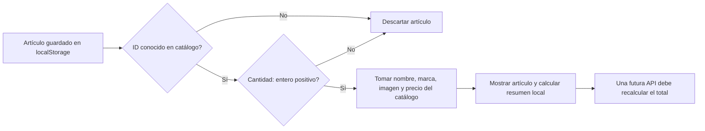
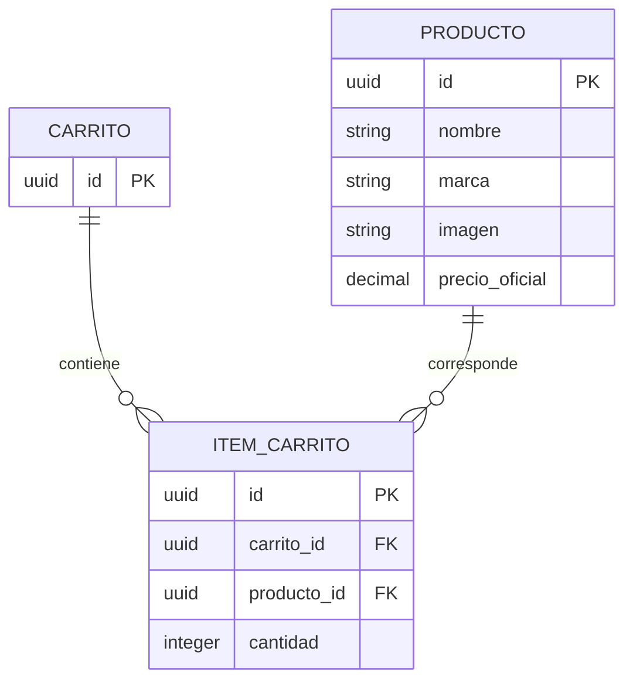
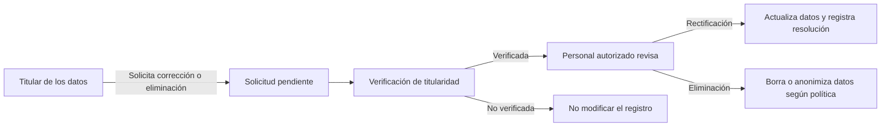

# Cambios y mejoras realizados en MobileZone

Este documento resume las correcciones realizadas a partir de la retroalimentación recibida sobre el modelo de datos, el carrito y la privacidad. Distingue entre mejoras implementadas en el frontend y propuestas para cuando se construya una base de datos o API.

## Resumen ejecutivo

| Tema | Antes | Mejora realizada | Estado |
|---|---|---|---|
| Restauración del carrito | Se confiaba en datos persistidos, incluidos precio, nombre y cantidades fraccionarias. | Se busca el producto por ID en el catálogo, se reconstruyen sus datos y se aceptan solo cantidades enteras positivas. | Implementado en React |
| Relación carrito-producto | El carrito guardaba una copia de varios datos del producto. | Se documentó un modelo relacional con Producto, Carrito e ItemCarrito, vinculados mediante claves foráneas. | Propuesta documentada; no hay base de datos |
| Precio | El cliente podía presentar datos inconsistentes como si fueran correctos. | Se distingue que el precio es público, pero su integridad es crítica; una futura API deberá recalcular los totales. | Mitigación local implementada; garantía del servidor pendiente |
| Privacidad de contacto | Se describía quién gestiona los mensajes, sin una vía para que el titular solicite cambios. | Se propusieron solicitudes verificadas de rectificación o eliminación, ejecutadas por personal autorizado. | Propuesta documentada; no está en la aplicación |
| Roles y permisos | Podían confundirse permisos propuestos con controles existentes. | Se aclaró qué roles y autorizaciones son futuros y deben aplicarse en el backend. | Documentado |
| Configuración Supabase | No existía cliente ni preparación local. | Se prepararon CLI, SDK, configuración inicial, variables de ejemplo y cliente centralizado. | Preparación local; falta autenticación y vinculación Cloud |

## 1. Carrito: producto canónico y cantidad válida

La restauración del carrito ahora acepta un artículo solo cuando su identificador existe en el catálogo y su cantidad es un entero positivo. Los datos del producto no se toman del almacenamiento local: se reconstruyen desde el catálogo.

| Caso de prueba | Resultado esperado y verificado |
|---|---|
| ID válido con `quantity: 0.5` | Se rechaza el artículo. |
| ID válido, nombre desconocido, precio persistido `1`, cantidad `1` | Se restaura con los datos canónicos del catálogo; para `iphone-15-pro`, el precio es `999`. |
| ID desconocido con cantidad `1` y precio alternativo | Se rechaza; no se utiliza el precio almacenado. |

La implementación está en [`restoreCartItems()`](../react-app/src/cart.js), se utiliza desde [`App.jsx`](../react-app/src/App.jsx) y está cubierta por [`cart.test.js`](../react-app/src/cart.test.js). Para que los IDs se comporten como una clave de producto en todas las páginas, se centralizaron las colecciones que pueden añadir productos al carrito en `cartProducts` dentro de [`catalog.js`](../react-app/src/data/catalog.js). La base de datos futura debería sustituir los IDs de presentación por un ID canónico y estable por producto.

### Comparación conceptual

| Modelo anterior | Modelo futuro sugerido |
|---|---|
| El carrito local guardaba `id`, nombre, marca, precio, imagen y cantidad como una copia del producto. | `ItemCarrito` guarda una clave foránea al producto, otra al carrito y una cantidad entera. |
| Un dato manipulado o anticuado podía no corresponder al catálogo. | La clave foránea exige que el producto exista y el precio se obtiene del catálogo. |
| El resumen se calcula en el navegador. | El backend valida los datos y vuelve a calcular la cotización desde su catálogo. |

Este diagrama describe una propuesta relacional, no tablas existentes. El esquema SQL ilustrativo y su explicación están en la sección 3 del [análisis CRUD y seguridad](./analisis-entidad-crud-seguridad.md).

## 2. Datos públicos e integridad del precio

| Dato | ¿Secreto? | Consideración |
|---|---|---|
| `brand`, `name`, `image` | No; son datos públicos del catálogo. | Se pueden mostrar a visitantes, pero la edición del catálogo debe estar protegida. |
| `price` | No necesariamente confidencial. | Su integridad comercial es crítica: el cliente puede mostrar una estimación, pero no fijar una cotización aceptada. |
| `quantity` | No es un dato confidencial. | Debe ser un entero positivo y validarse tanto en el cliente como en el servidor. |
| Nombre, correo y mensaje de contacto | Sí, son datos personales; el mensaje puede contener información privada. | Acceso limitado, verificación de titularidad y política de conservación. |

La validación local evita algunos resúmenes incoherentes, pero no hace confiable al navegador. Antes de aceptar una compra, una futura API deberá recibir IDs y cantidades, verificar disponibilidad y volver a calcular el total utilizando los precios autorizados del servidor.

## 3. Privacidad y permisos propuestos

Se incorporó al análisis una propuesta separada para mensajes de contacto y solicitudes de privacidad. El titular podría solicitar rectificación o eliminación, pero no modificar directamente el registro ni consultar mensajes ajenos.

| Actor | Permiso propuesto |
|---|---|
| Visitante/titular | Crear una solicitud de rectificación o eliminación y consultar su estado mediante un canal verificado. |
| Personal autorizado de atención | Verificar y tramitar la solicitud, actualizar su estado y ejecutar la corrección o eliminación. |
| Administrador del catálogo | Administrar productos y precios, sin que eso otorgue automáticamente acceso a mensajes personales. |

Las tablas SQL para `contact_messages`, `privacy_requests` y el registro de personal autorizado son solo una propuesta. La aplicación actual no envía ni guarda mensajes en una base de datos, y no implementa autenticación ni roles. El detalle se encuentra en el [análisis CRUD y seguridad](./analisis-entidad-crud-seguridad.md).

## 4. Preparación inicial para Supabase Cloud

Se añadieron la Supabase CLI como dependencia de desarrollo, el SDK `@supabase/supabase-js`, una plantilla de variables Vite, reglas para ignorar archivos locales de entorno y un cliente Supabase centralizado. La guía está en [`SUPABASE_SETUP.md`](../SUPABASE_SETUP.md).

| Elemento | Estado |
|---|---|
| CLI y SDK instalados en `react-app` | Preparado |
| `supabase/config.toml` inicializado | Preparado localmente |
| Cliente centralizado y `.env.example` | Preparados |
| Autenticación de la CLI | Pendiente |
| Selección del proyecto Cloud y `supabase link` | Pendiente |
| Esquema, tablas, migraciones y datos remotos | No creados ni modificados |

No se deben guardar claves secretas en el repositorio ni exponer una clave `service_role` en una app Vite. La integración con Cloud no se considera completa hasta autenticar la CLI, elegir el proyecto correcto y configurar localmente su URL y clave publicable.

## 5. Validación y archivos de referencia

En la validación del cambio del carrito y del cliente inicial de Supabase pasaron **9 pruebas** y la compilación de producción. Las pruebas verifican lógica local; no prueban autorización, API ni una base de datos remota.

| Recurso | Contenido |
|---|---|
| [`analisis-entidad-crud-seguridad.md`](./analisis-entidad-crud-seguridad.md) | Análisis de entidad, permisos, propuestas relacionales, privacidad y validación del carrito. |
| [`cart.js`](../react-app/src/cart.js) | Restauración segura y reconstrucción del carrito desde el catálogo. |
| [`cart.test.js`](../react-app/src/cart.test.js) | Casos de cantidad fraccionaria, datos manipulados e ID desconocido. |
| [`catalog.js`](../react-app/src/data/catalog.js) | Productos y colección común para identificar productos restaurables. |
| [`supabase.js`](../react-app/src/lib/supabase.js) | Inicialización centralizada del cliente Supabase. |
| [`SUPABASE_SETUP.md`](../SUPABASE_SETUP.md) | Guía de preparación, variables y pasos pendientes para Supabase Cloud. |

### Próximos pasos recomendados

1. Normalizar los IDs de producto entre catálogo, ofertas, comparación y landing.
2. Elegir y vincular un proyecto Supabase Cloud; no ejecutar cambios de esquema sin una decisión explícita.
3. Diseñar las políticas de acceso y la autorización antes de guardar mensajes, carritos o precios en Cloud.
4. Implementar cotizaciones en una API o función de servidor que recalcule los totales.
5. Definir plazos de conservación y el flujo de verificación para solicitudes de privacidad.
